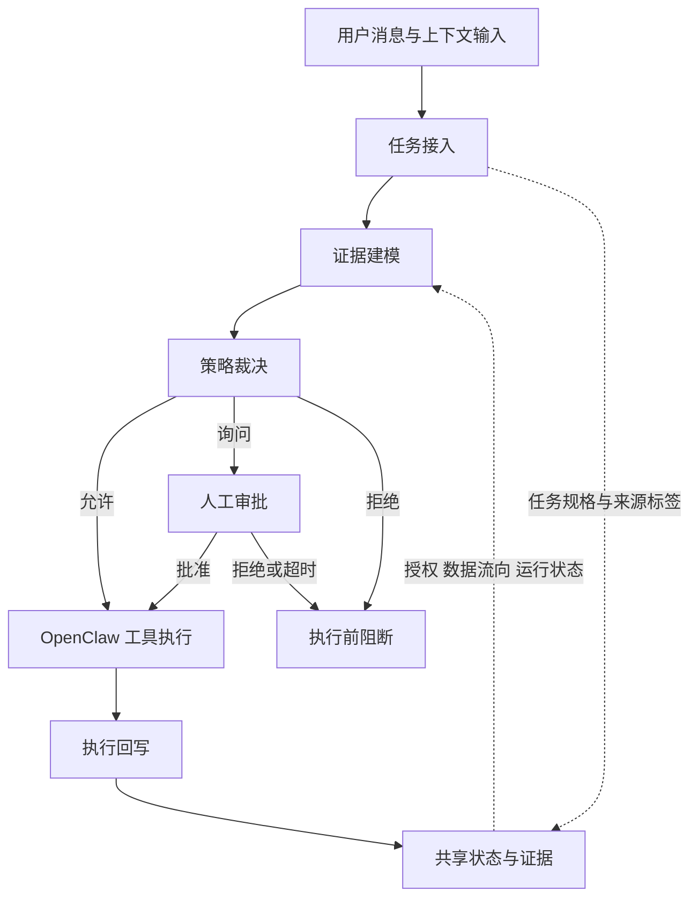

# 玄鉴 / AgentSentry

> 面向智能体工具调用链的实时行为监督与风险拦截系统

[](https://github.com/ling101w/AgentSentry-/actions/workflows/ci.yml)
[](LICENSE)

## 项目概述

随着大语言模型与工具调用能力的快速发展，智能体已逐渐从单轮问答工具转向能够读取文件、访问网页、调用接口、发送邮件和执行命令的任务执行系统。外部网页、邮件、文档、工具返回和第三方技能等内容都可能进入模型上下文，并进一步影响工具调用结果。在此背景下，单纯依赖提示词过滤或模型自身拒答，难以有效应对外部内容注入、记忆污染和工具调用劫持等运行时风险。

玄鉴是一套面向 OpenClaw 工具型智能体的嵌入式运行时安全治理系统。系统以插件形式接入 OpenClaw 的消息处理、工具调用和结果回调生命周期，在保留智能体原有任务执行能力的基础上，对用户任务、上下文内容、工具参数、工具结果和会话运行状态进行统一治理。作品主要面向提示注入、工具调用劫持、记忆污染，以及由此引发的数据外泄和危险操作等安全风险。

系统将智能体执行过程划分为任务接入、证据建模、策略裁决和执行回写四个阶段，并围绕控权、控流、控态三类机制组织安全能力。三类机制通过共享状态与证据相互衔接，在工具执行前形成允许、询问或拒绝结果，在工具执行后更新数据溯源与会话状态，为下一次调用提供判断依据。

玄鉴为作品名称，`AgentSentry` 为仓库与 OpenClaw 插件的工程名称。

## 总体架构

系统整体由 OpenClaw 接入层、玄鉴安全治理层、共享状态与证据层以及 OpenClaw 运行时组成。接入层汇集用户消息、上下文消息、工作区、Skill、Plugin 和记忆等输入来源；共享状态与证据层保存任务规格、工具安全清单、信任标签、数据溯源、风险状态和语义动作关系；OpenClaw 运行时负责模型推理、工具调用、工具执行和结果返回。

玄鉴位于输入与执行链路之间。权限边界、信息流向和运行状态三个安全控制维度贯穿四个阶段，形成“任务接入—证据建模—策略裁决—执行回写—下一次调用”的闭环安全架构。



### 任务接入

任务接入阶段负责接收用户消息、上下文消息、工作区内容、Skill、Plugin 和记忆等输入信息，并建立当前会话的初始安全状态。系统识别输入来源及其可信程度，对任务文本进行规范化处理，提取用户明确表达的动作、目标和约束条件，形成当前任务的授权范围。来源扫描和内容检测同时识别提示注入、隐藏指令、敏感内容及潜在污染来源，为后续调用提供初始证据。

### 证据建模

证据建模阶段处理模型生成的候选工具调用。系统对工具名称和调用参数进行规范化，识别动作类型、目标资源、参数范围和潜在副作用，并将其与任务授权范围进行对应。授权核验检查路径、主机、请求方法、收件人和命令等约束；数据流向分析判断参数是否承载来自历史工具结果的敏感或低可信数据；状态分析结合调用历史与行为基线识别任务偏移和风险累积。

### 策略裁决

策略裁决阶段对授权证据、数据流向证据和运行状态证据进行统一评估，输出允许（`allow`）、询问（`ask`）或拒绝（`deny`）结果。满足约束的调用进入允许路径，存在风险不确定性的调用进入人工审批路径，明确越过安全边界的调用形成拒绝结果。常规策略按照安全等级从严合并，确定性安全边界优先保留；可选的语义复核用于补充歧义判断，不能放宽确定性裁决。

裁决与实际执行通过运行模式衔接。在 `approval` 和 `block` 模式下，询问结果需要人工审批，拒绝结果在执行前被阻断，确定性硬拒绝不能由人工审批覆盖；`observe` 模式记录裁决与运行过程，不保证阻断。

### 执行回写

执行回写阶段负责处理工具执行后的结果和运行信息。系统在工具结果返回后完成结果标记、字段级数据溯源、动作关系更新和风险状态回写，并保存工具决策、执行结果和运行告警。新的数据溯源、风险状态和动作关系进入共享状态与证据层，作为下一次工具调用的判断依据。

## 核心安全控制机制

### 控权：基于 TaskSpec 的任务授权

控权以当前 TaskSpec 为授权基线，对智能体可使用的工具、可执行的动作、可访问的资源、可操作的目标及其副作用范围进行约束。TaskSpec 根据权威用户请求生成，描述动作、资源、目标、副作用和参数约束，使授权粒度细化为“在当前任务中，可以使用该工具对哪些目标执行何种操作”。模型生成调用后，系统逐项核验实际工具、文件路径、网络主机、请求方法、邮件收件人和命令内容。

复杂请求可通过受约束的语义解析补充结构化候选，候选能力继续接受授权来源、目标具体性和副作用范围校验。工具结果、网页内容和普通记忆内容不能直接扩展 TaskSpec。人工审批与工具、规范化参数、TaskSpec 和安全配置共同绑定，并通过完整性签名、有效期和使用次数限制复用范围，避免历史批准被用于不同目标或不同参数的操作。

### 控流：跨调用的字段级信息流治理

控流以字段为最小追踪单位，记录数据由何种输入或工具产生、经过何种转换、被哪次调用使用以及最终流向何处。结构化工具结果被展开为独立字段，每个字段分别记录来源、路径、父级关系、机密性、完整性、内容指纹和转换过程。后续工具参数与历史字段发生实际关联时，系统传播对应的信任标签和风险属性，使同一结果中的正常数据与污染数据能够分别处理。

语义动作图关联任务意图、授权能力、输入数据、工具动作和目标出口，记录数据的消费、派生与产出关系。信息流控制、属性流向策略和记忆信息流控制共同检查低可信或敏感数据是否进入邮件发送、网络请求、命令执行、文件写入和长期记忆等出口。工具执行结果重新生成字段标签和溯源关系，并写回会话证据，形成“结果标记—参数传播—出口核验—证据回写”的跨调用闭环。

### 控态：会话状态驱动的动态安全调节

控态以会话为基本安全单元，持续记录任务上下文、决策历史、风险向量、行为基线和运行异常，并依据状态变化调整后续工具调用的执行条件。风险向量保留不同安全维度中已经出现的高风险证据；行为基线描述同类任务中的常见工具、主机、收件人、路径和参数结构；滑动风险窗口记录近期调用及其裁决结果，用于识别行为偏移、工具分布漂移和风险累积。

动态安全等级根据近期高风险事件逐级提升，并按外部写入、持久化和命令执行等动作类型增加审批或阻断要求；会话连续保持安全后，控制等级逐步恢复。对于受支持的本地操作，检查点和 Shell 工作区影子提供执行保护；部署 eBPF observer 时，运行审计证据可进一步写入工具画像与会话状态，增强后续调用约束。

## 主要治理场景

| 风险类型 | 典型场景 | 治理机制 |
|---|---|---|
| 提示注入 | 外部网页、邮件或工具结果携带隐藏指令，诱导智能体偏离用户任务 | 来源分级、字段级溯源、污点传播与敏感出口核验 |
| 工具调用劫持 | 调用参数、目标地址或工具身份被替换，导致越权操作或敏感数据外发 | TaskSpec 目标与参数约束、工具安全清单、路径与网络边界检查 |
| 记忆污染 | 低可信内容写入长期记忆，并持续影响后续任务 | 记忆信息流控制、Memory Guard 完整性校验、来源约束与会话风险更新 |

## 部署与使用

玄鉴的主要运行系统位于 `openclaw-plugin/`。插件接入 OpenClaw 工具调用生命周期，配套控制台提供策略配置、人工审批、可视化监控与审计查询。安装环境要求 Node.js 24、npm 和 OpenClaw `>=2026.3.28`；Python 3.13 用于离线原型、评测工具与 Python 测试。

### Windows PowerShell

```powershell
git clone https://github.com/ling101w/AgentSentry-.git
cd .\AgentSentry-\openclaw-plugin
npm ci --legacy-peer-deps
npm run ci
.\setup.ps1 -Force
```

### Linux / macOS

```bash
git clone https://github.com/ling101w/AgentSentry-.git
cd AgentSentry-/openclaw-plugin
npm ci --legacy-peer-deps
npm run ci
bash setup.sh --force
```

安装完成并重启 OpenClaw Gateway 后，可通过以下命令启用比赛配置并查看运行状态：

```text
/agentsentry profile competition
/agentsentry status
```

状态信息包含认证控制台地址、当前配置档位、执行模式、会话数量、核心防线状态和审计记录路径。审计记录默认以 JSONL 格式保存于：

```text
~/.openclaw/agentsentry/records.jsonl
```

### 策略配置

系统提供观察、审批和阻断等执行模式，并通过配置档位组织不同部署需求下的安全能力。

| 配置档位 | 执行模式 | 适用场景 |
|---|---|---|
| `observe` | `observe` | 记录裁决与告警，用于运行观察和无阻断基线 |
| `balanced` | `approval` | 日常使用，对需要确认的调用执行人工审批 |
| `competition` | `approval` | 比赛演示，启用溯源语义复核、写入范围约束与响应覆盖 |
| `high-security` | `block` | 强约束部署，要求高风险运行面具备内核观测能力 |

常用配置与审批命令如下：

```text
/agentsentry status
/agentsentry profile <observe|balanced|competition|high-security>
/agentsentry config get [key]
/agentsentry config set <key> <value>
/agentsentry config reset
/agentsentry approvals [status|reset]
/agentsentry reset
```

可选的语义复核使用独立环境变量配置服务密钥。以下为 PowerShell 配置示例：

```powershell
$env:AGENTSENTRY_API_KEY="YOUR_JUDGE_KEY"
```

```text
/agentsentry config set semantic.enabled true
/agentsentry config set semantic.baseUrl https://api.openai.com/v1
/agentsentry config set semantic.model gpt-4o-mini
/agentsentry config set semantic.apiKeyEnv AGENTSENTRY_API_KEY
```

未配置密钥、网络不可用或语义复核超时时，确定性策略继续生效。

### 可视化监控与审计

控制台围绕会话、工具调用和策略裁决展示运行证据，提供三个主要视图：

| 视图 | 功能 |
|---|---|
| `/` | 展示实时语义动作图、攻击路径、裁决依据与执行回放 |
| `/command-lab` | 对受控业务工具与公开攻击样例进行逐条复测 |
| `/security-screen` | 展示全局安全态势、告警时间线与拓扑关系 |

在 OpenClaw 中执行 `/agentsentry` 后，使用返回的认证 URL 进入控制台。控制台默认绑定本机回环地址，通过引导令牌建立认证会话；首次直接访问 `http://127.0.0.1:8765/` 返回 `401`。远程访问需要显式启用并配置认证令牌。

### 演示与复现

1. 启用 `competition` 配置，执行 `/agentsentry` 并打开返回的认证 URL。
2. 进入 `/command-lab`，运行普通文件写入或健康检查样例，观察正常调用的裁决与执行结果。
3. 运行隐藏指令、敏感数据外发或记忆污染样例，查看调用是否进入人工审批或执行前阻断路径。
4. 返回首页，通过语义动作图和详情面板查看授权依据、数据传播路径、目标出口与最终裁决。
5. 结合执行回放和审计记录，核对工具调用、执行结果及会话状态更新过程。

完整演示步骤与实验复现方法见[演示与复现实验指南](reports/demo_and_reproduction.md)。

## 评测口径

仓库保存了两组公开内容映射后的开发回归：综合攻击回归 520 条、工具攻击专项 320 条。这些结果用于规则回归、误报检查和消融，但必须明确：

- 它们不是独立盲测。
- 它们不是 AgentDojo/InjecAgent 原生端到端成绩。
- 历史标签不会进入 detector 输入；新的评测协议将 labels 保留在 evaluator-owned envelope。
- Native AgentDojo adapter、doctor/plan/contract 已实现。下述历史模型运行结果已经在本地完成；最新安全修复分支的模型驱动成绩仍需重新运行。

指标、标签隔离和证据等级见 [EVALUATION_METHODOLOGY.md](reports/EVALUATION_METHODOLOGY.md)。

### 已在本地运行的 AgentDojo / DeepTrap

以下两组是 **2026 年 8 月在本地实际运行的模型 benchmark**，2026-10-13 从留存结果核对并提交数据、评分记录与图表。它们对应历史版本，不是最新修复分支的重新评测。完整数据、run ID、版本、分母和复核方法见 [本地 benchmark 数据说明](reports/local-benchmarks-202608/README.md)。

AgentDojo Native Expanded v1：DeepSeek V4 Pro，workspace v1.2.2，每组 100 攻击 + 40 正常任务。

| 方法 | 官方 ASR ↓ | FPR（正常任务 deny）↓ | 正常 Utility ↑ |
| --- | ---: | ---: | ---: |
| 无防护 No Defense | 61.0% | 0% | 87.5% |
| 玄鉴 Risk-based | 1.0% | 25.0% | 67.5% |
| 玄鉴 Evidence-gated | 0% | 0% | 92.5% |
| 玄甲 AgentWard | 2.0% | 2.5% | 97.5% |


四组均有 140/140 最终完成记录。AgentWard 属于 dirty worktree 开发运行，`reportable=false`；与玄鉴使用不同 provider，此表作相同 case 的描述性对比。Evidence-gated 是后验优化发布复跑。AgentWard 官方 ASR 为 2%，独立审计的实际危险副作用为 4%，两者口径不同。

DeepTrap：DeepSeek V4 Flash，每组 42 个预污染任务，六类风险各 7 条。

| 方法 | AGS ↓ | 攻击环境 UGS ↑ |
| --- | ---: | ---: |
| 无防护 No Defense | 0.3361 | 0.4119 |
| 玄鉴 Risk-based | 0.1428 | 0.1119 |
| 玄鉴 Evidence-gated | 0.2371 | 0.2167 |
| 玄甲 AgentWard | 0.2909 | 0.1548 |


DeepTrap 的 AGS/UGS 已从 168 条任务数值复算，与图表一致。UGS 是攻击环境效用，不能当作 clean Utility/FPR；原记录包含 timeout/error，42/42 评分有效不代表执行全部无错误。状态、历史 ask 放行行为及审计完整性限制详见数据说明。

## 工程验证

插件验证覆盖类型检查、代码规范、单元与集成测试、策略与安全冒烟测试、属性与模糊测试，以及 AgentDojo 桥接自检。以下命令在仓库根目录执行：

```powershell
npm --prefix openclaw-plugin run ci
npm --prefix openclaw-plugin run sbom
```

Python 离线原型与评测工具可通过以下命令安装和验证：

```powershell
python -m pip install -e ".[dev]"
python -m pytest -q
```

## 适用范围与后续工作

玄鉴的主要执行链由 OpenClaw 插件与认证控制台构成，`src/agentsentry/` 中的 FastAPI 服务用于早期离线原型和辅助研究。生产行为检测采用轻量在线统计基线；图学习相关代码仍属于研究模块，尚未证明稳定增益，不作为当前确定性阻断的依据。

执行保护受工具实现和部署环境约束。eBPF observer 可记录 `execve`、`openat` 等运行事件，当前 `connect` 观测记录进程与文件描述符信息，不解析网络目标地址；网络目标控制由应用层地址检查、命令预检与部署侧出口策略承担。文件路径检查发生在工具打开路径之前，仍存在检查与使用之间的时间窗口，更强的文件隔离需要工具侧配合 `openat`、`O_NOFOLLOW` 或已检查的文件描述符。

后续工作将进一步完善复杂组合任务下的授权表达，提高跨工具转换和非结构化结果的数据溯源精度，并加强长期记忆分级治理及运行证据与应用层策略之间的关联。同时，系统将继续优化风险阈值、人工审批和精确操作复用机制，以适应更长会话和更复杂的真实业务环境。

## 目录结构

| 路径 | 作用 |
|---|---|
| `openclaw-plugin/` | OpenClaw 插件、策略裁决、控制台、测试与配置档位 |
| `openclaw-plugin/core/task-spec/` | 任务授权规格提取与能力边界核验 |
| `openclaw-plugin/core/taint/` | 字段级数据溯源与污点传播 |
| `openclaw-plugin/core/policy/` | 动作风险评估、行为基线与策略辅助逻辑 |
| `openclaw-plugin/core/persistence/` | 审计事件的异步批量写入 |
| `reports/` | 作品报告、评测说明、实验结果与验收证据 |
| `evaluation/` | 标签隔离评测协议与原生评测适配 |
| `cases/`、`policies/` | 中文安全案例与离线策略材料 |
| `scripts/` | 评测、验收、发布与界面检查脚本 |
| `src/`、`tests/` | Python 离线原型及相关测试 |
| `output/` | 插件发布包与交付材料 |

完整结构说明见 [PROJECT_STRUCTURE.md](PROJECT_STRUCTURE.md)。

## 相关文档

| 文档 | 内容 |
|---|---|
| [文档索引](reports/START_HERE.md) | 项目材料与运行入口 |
| [作品报告](reports/competition_report.md) | 作品背景、系统方案与验证说明 |
| [系统功能说明](reports/system_functionality.md) | 功能实现与数据来源 |
| [技术设计与算法](reports/technical_design_and_algorithms.md) | TaskSpec、数据溯源、记忆保护与语义复核 |
| [演示与复现实验指南](reports/demo_and_reproduction.md) | 演示步骤与 benchmark 复现方法 |
| [插件说明](openclaw-plugin/README.md) | 插件安装、配置与开发 |
| [发布部署说明](README_RELEASE.md) | 交付包安装与部署 |

## 发布包

仓库保留以下兼容发布包路径，具体部署与版本信息见[发布部署说明](README_RELEASE.md)：

```text
output/xuanjian-openclaw-plugin-20260703.tar.gz
```

重新构建与计算校验值可使用：

```powershell
powershell.exe -NoProfile -ExecutionPolicy Bypass -File .\scripts\build_release_archive.ps1
Get-FileHash -Algorithm SHA256 .\output\xuanjian-openclaw-plugin-20260703.tar.gz
```

## 开源许可

本项目采用 [Apache License 2.0](LICENSE)。
