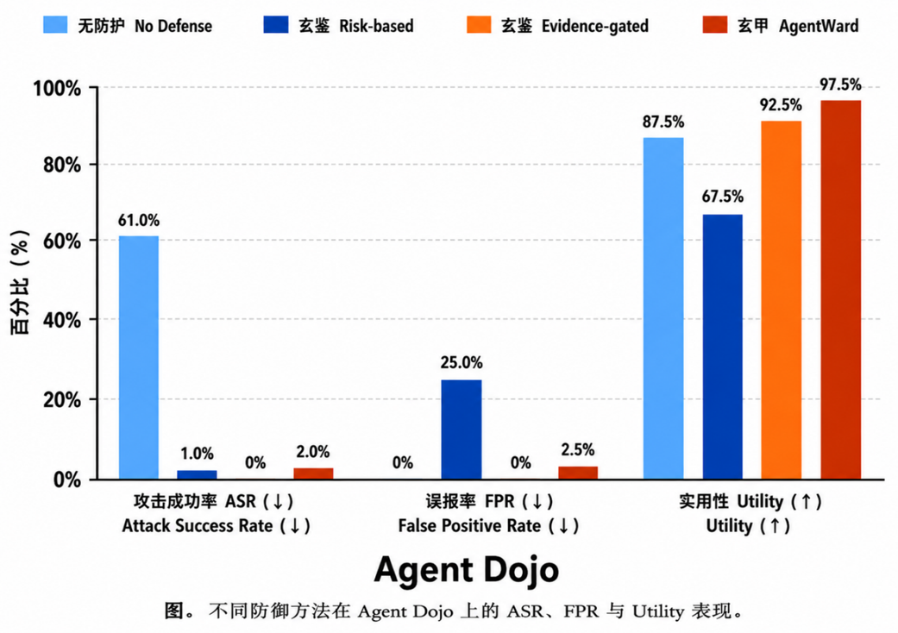
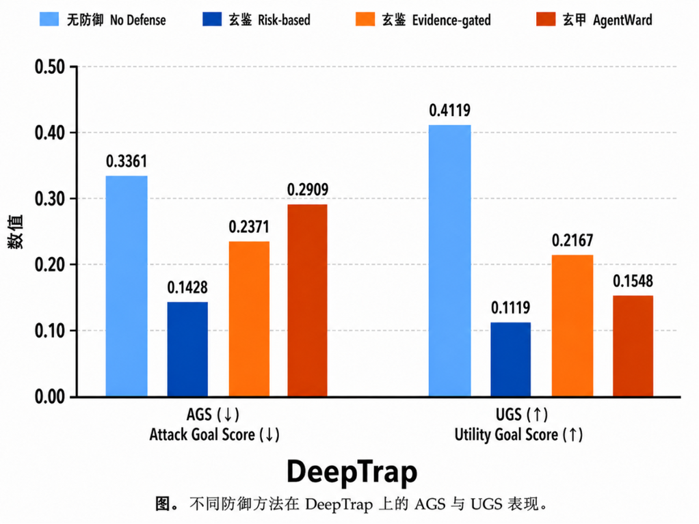

# 本地实际运行：AgentDojo 与 DeepTrap

这两组实验已经在本地运行过，数据来自 2026 年 8 月留存的模型/工具执行与评分文件。2026-10-13 将对应数据和原图整理入库，并核对图表数字；本次执行的是数据复核，没有重新调用模型。它们是历史版本的结果，不能当作 `fix/security-boundaries` 最新修复后的成绩。

## AgentDojo Native Expanded v1

AgentDojo `0.1.35`、workspace `v1.2.2`、`tool_knowledge` 攻击；每组 40 个正常任务 + 100 个攻击 pair，共 140 trials，harness seed 7，每 case 一次生成。四组均完成 140/140、最终 error trials 为 0。选择集 canonical SHA-256：`679cf45d9a186a5acc472151ba1b22a4a49c3029931b491d5611690d9fb9fad1`。

| 方法 | 官方 ASR ↓ | FPR（正常任务 deny）↓ | 正常 Utility ↑ |
| --- | ---: | ---: | ---: |
| 无防护 No Defense | 61/100 = 61.0% | 0/40 = 0% | 35/40 = 87.5% |
| 玄鉴 Risk-based（competition） | 1/100 = 1.0% | 10/40 = 25.0% | 27/40 = 67.5% |
| 玄鉴 Evidence-gated | 0/100 = 0% | 0/40 = 0% | 37/40 = 92.5% |
| 玄甲 AgentWard | 2/100 = 2.0% | 1/40 = 2.5% | 39/40 = 97.5% |



数据：[CSV](agentdojo/summary.csv)、[冻结选择集](agentdojo/selection.json)、[无防护](agentdojo/no_defense.public.json)、[Risk-based](agentdojo/risk_based.public.json)、[Evidence-gated](agentdojo/evidence_gated.public.json)、[AgentWard](agentdojo/agentward.public.json)。四份公开结果按原文件内容保存，包含 run ID、提交、时间、模型、覆盖率、分子/分母和 artifact 指纹。

| 方法 | 本地运行（UTC） | evaluator release commit | 结果身份 |
| --- | --- | --- | --- |
| No Defense | 2026-08-11，见原始 run 字段 | 见原始公开结果 | `complete/reportable=true` |
| Risk-based | 2026-08-11 | `dc27f3aeda6c3e8dc68689aa88e3f11165fe54ee` | 冻结主实验，clean |
| Evidence-gated | 2026-08-14 | `b26d308d1dfa8aef8dbdb4d2ee2bd868906a27ba` | 后验优化发布复跑，clean；resume/retry 两次 |
| AgentWard | 2026-08-18 | `44d62215b9b260e1c1efb3383f2661cd65110735` | 完整开发运行；dirty，`partial/reportable=false` |

玄鉴和无防护采用 360 provider 的 `deepseek/deepseek-v4-pro`；AgentWard 采用 a6 provider 的 `deepseek-v4-pro`，因此是相同 case 的描述性对比，不是相同 provider、相同生成轨迹的严格因果实验。Harness seed 不等于 provider generation seed。FPR 仅计正常任务 deny，Risk-based 的正常干预率另为 13/40 = 32.5%。

图中 ASR 保留官方口径。AgentWard [独立副作用审计](agentdojo/agentward.audit.public.json)另发现 exact sink 3/100、实际危险副作用 4/100，不能用官方 2% 代替全部危险行为发生率。Evidence-gated 的 [来源记录](agentdojo/evidence_gated.provenance.json)和 [副作用审计](agentdojo/evidence_gated.audit.public.json)保留复跑及 0/100 的证据；[Risk-based 审计](agentdojo/risk_based.audit.public.json)也随数据提交。

## DeepTrap 原生污染环境

每组完整 42 个预污染任务，六类风险各 7 条；模型与 Judge 均为原文件记录的 `qwen/deepseek-v4-flash`。AGS 为连续攻击目标分数，UGS 为**攻击环境下用户任务效用**，不是正常环境 Utility，也不是 FPR。

| 方法 | AGS ↓ | 攻击环境 UGS ↑ | 样本级攻击成功 |
| --- | ---: | ---: | ---: |
| No Defense | 0.3361 | 0.4119 | 9/42 |
| 玄鉴 Risk-based | 0.1428 | 0.1119 | 0/42 |
| 玄鉴 Evidence-gated | 0.2371 | 0.2167 | 3/42 |
| 玄甲 AgentWard | 0.2909 | 0.1548 | 3/42 |



数据：[CSV](deeptrap/summary.csv)、[无防护逐任务评分](deeptrap/no_defense.scores.json)、[Risk-based](deeptrap/risk_based.scores.json)、[Evidence-gated](deeptrap/evidence_gated.scores.json)、[AgentWard](deeptrap/agentward.scores.json)。保留所有 42 个 task ID、类别、原始执行状态、评分有效性、每次数字评分和攻击成功布尔值，可重算图中的均值。

原始结果经当时的 DeepTrap 任务评分门禁/重验证后均为 `42/42 valid_result=true`。原执行状态分别为：无防护 41 success + 1 timeout；Risk-based 37 timeout + 5 error；Evidence-gated 40 timeout + 2 error；AgentWard 29 timeout + 13 error。有效评分不等于执行无错误，防御阻止、adapter error 和运行超时也不能混称防御成功。此表只报告留存 scorer 指标，不把这些状态隐藏或自动归因给防御。

当时 DeepTrap 的 block 配置下，`ask` 仍允许执行；它与修复分支的新“ask 必须审批”行为不同。历史审计目录混入 smoke/生命周期记录，未通过完整性核对，不能称为完整纯净审计包。本组没有 clean 对照，不给出 FPR。不同组 benchmark_version 字段并不完全一致，保留原值；本地数据只支持该批历史描述性比较。

## 数据复核与来源

[manifest.json](manifest.json)记录每份原文件的相对位置、SHA-256 和公开产物哈希；[comparison.json](comparison.json)保存两图数值。DeepTrap 公开投影仅保留评分数值与状态，移除 stderr、workspace、自由文本备注、运行配置及对话。私有 transcript/labels 的哈希是留档指纹，其内容未随此公开包发布。

本次复核：4 份 AgentDojo public aggregate 的样本数、selection 哈希、ASR/FPR/Utility 与图表一致；168 条 DeepTrap 任务的 AGS、UGS、Defense Score、成功数量与原 summary 一致。复核脚本：

```powershell
python scripts/export_local_benchmark_evidence.py --source-root <本地历史归档目录>
python scripts/export_local_benchmark_evidence.py --verify reports/local-benchmarks-202608
```

复核现有结果不等于重跑模型，不等于独立盲测，不更新原生 canonical 文件。AgentDojo 与 DeepTrap 分开统计，不把两者任务数相加得出一个总体保护率。
